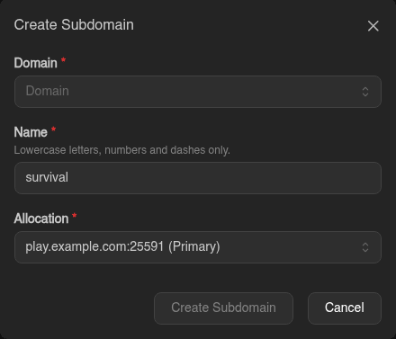
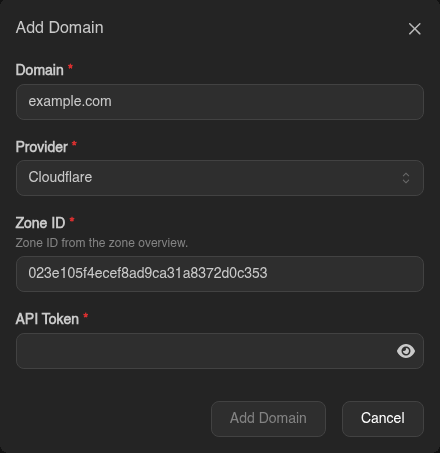
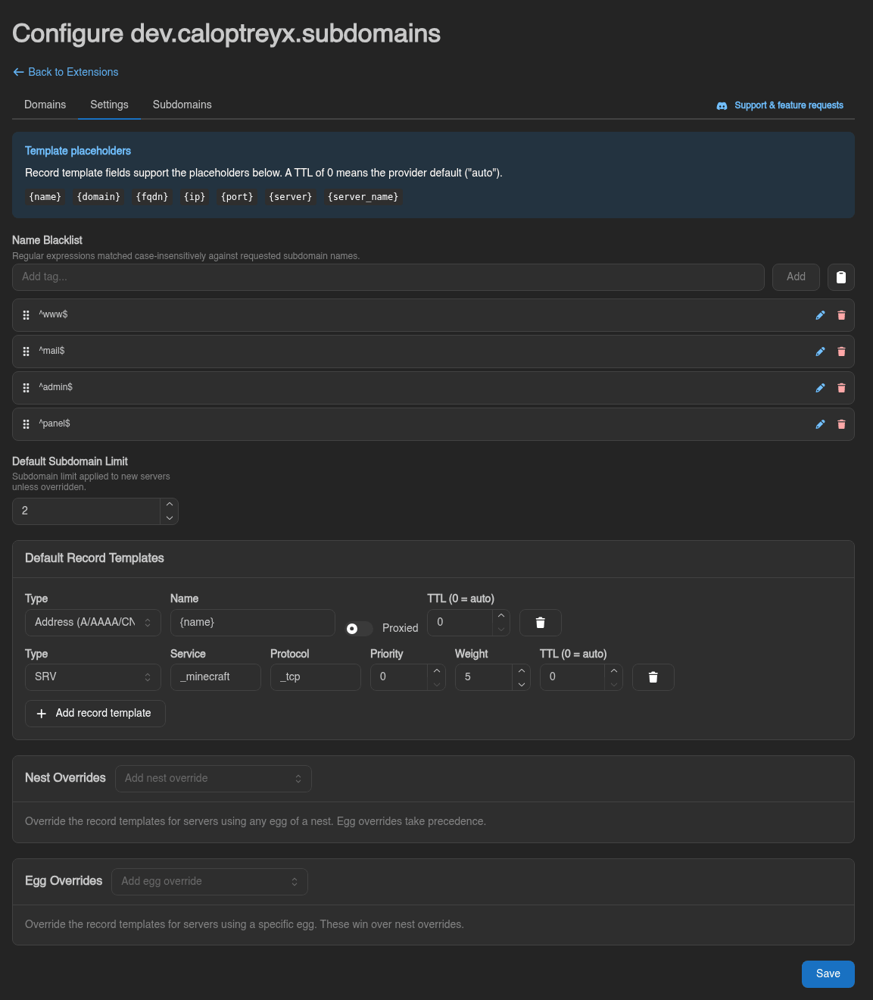

# Subdomain Manager

A [Calagopus Panel](https://calagopus.com) extension that lets users create and manage
subdomains for their game servers (mainly Minecraft) through **Cloudflare**, **Bunny.net DNS** or
**PowerDNS**.

Package name: `dev.caloptreyx.subdomains` · Requires panel `>=1.2.10`

## Features

- Users pick a domain, a name and one of their server's allocations; the extension creates the
  DNS records and shows the resulting `name.domain`.
- Seamless Minecraft integration: default record set is an address record plus a
  `_minecraft._tcp` SRV record, so players connect without typing a port.
- **Per-nest and per-egg record templates** with placeholders (`{name}`, `{domain}`, `{fqdn}`,
  `{ip}`, `{port}`, `{server}`, `{server_name}`) – e.g. one set for every egg in a Minecraft nest,
  an A-only set for Minecraft Bedrock, or extra custom A/AAAA/CNAME/TXT records.
- **IP alias parsing**: the allocation's alias is used as the record target; hostnames become CNAME,
  IPv4 becomes A, IPv6 becomes AAAA.
- **Blacklist** subdomain names with regular expressions.
- **Per-server subdomain limit** exposed as `feature_limits.subdomains` and editable in the admin
  server create/update forms.
- **Proper cleanup**: DNS records are removed when a subdomain, its server or its allocation is
  deleted, and when a server is transferred to another node.
- **Leaves existing DNS records alone**: before creating records the extension asks the provider
  whether each record name is free, and refuses (409) if the name already has records of any
  type. It only ever deletes the records it created itself.
- **Allocation changes at any time**; after a server transfer the allocation is set to `null`
  (Unknown) so the user can re-point the subdomain, which creates new records.
- Admin overview of every subdomain across the panel, with search.

## Installation

Download `dev_caloptreyx_subdomains.c7s.zip` from the
[latest release](https://github.com/Caloptreyx/Subdomain-Manager/releases/latest) and either upload it under **Admin → Extensions**
or drop it into your heavy image's `build/extensions/` directory and `docker compose restart web`.
Extensions require the `:heavy` panel image (or a dev environment) — see the
[Calagopus docs](https://calagopus.com/docs/panel/extensions/installing-extensions).

## Configuration

**Admin → Extensions → Subdomain Manager → Configure**

- **Domains** – add the domains users may choose from.
  - *Cloudflare*: Zone ID (zone overview page) + an API token with `Zone:DNS:Edit` on that zone.
  - *Bunny.net*: numeric DNS zone id (from the dashboard URL) + an account API key.
  - *PowerDNS* (Authoritative, HTTP API enabled): zone name (e.g. `example.com`) + the webserver
    URL (e.g. `http://10.0.0.2:8081`, must be reachable from the panel container) + the `api-key`.
    The URL and key are stored together, so changing either requires entering both.
  Credentials are verified against the provider before saving and stored encrypted.
- **Settings** – blacklist regexes, default subdomain limit for new servers, default record
  templates, per-nest overrides and per-egg overrides. A server's egg override wins, then its
  nest's override, then the defaults. A TTL of `0` means "provider automatic" (300s on PowerDNS,
  which has no automatic TTL).
- **Subdomains** – searchable list of all subdomains with their servers. Admins can create
  subdomains on any server (not bound by the server limit or the name blacklist), move a subdomain
  to another allocation of its server, and delete it (with a forced delete if the DNS provider
  fails).

Permissions: server `subdomains.read|create|update|delete`, admin `subdomains.read|manage`.

## Screenshots

**Create Subdomain** – users pick a domain, a name and one of their server's allocations.

**Add Domain** – admins add a DNS zone with its provider and credentials.

**Settings** – name blacklist, default subdomain limit, default record templates and per-nest and
per-egg overrides.

## API

- `GET|POST /api/client/servers/{server}/subdomains`, `PATCH|DELETE .../subdomains/{uuid}`
- `GET|PUT /api/admin/extensions/dev.caloptreyx.subdomains/settings`
- `GET|POST .../domains`, `PATCH|DELETE .../domains/{uuid}`, `POST .../domains/{uuid}/verify`
- `GET|POST .../subdomains` (list with `page&per_page&search`, admin create),
  `PATCH|DELETE .../subdomains/{uuid}`

Full schemas are in the panel's OpenAPI document once installed.

## Roadmap

- CLI command to migrate data from the Pterodactyl subdomain manager extension.

## Support

Need help or want to request a feature? Join the [Caloptreyx Discord](https://discord.gg/4qjMWU7S8x).

## License

MIT
